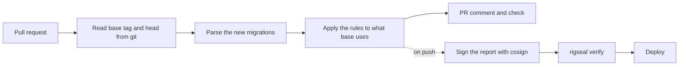

<picture>
  <source media="(prefers-color-scheme: dark)" srcset="assets/banner-dark.png">
  
</picture>

**Rigseal** is a GitHub Action that checks whether a pull request's Prisma migrations would break
the previous release if you had to roll back. It answers `SAFE`, `RISKY` or `UNSAFE`, with a reason and
a fix, and can sign that verdict so a deploy can check it.

**The name:** Rigseal puts a seal on your release rig. It checks a release's migrations before it
ships, and seals the verdict with a signature that the deploy checks.

## The problem

When a release goes wrong you redeploy the old code, but the database stays migrated. A one-line field
rename makes Prisma generate `DROP COLUMN` + `ADD COLUMN`, and after a rollback the old code fails on
**every** query of that model. Prisma gives no warning. Rigseal catches it in the pull request.

<p align="center">
  
</p>

The same feature done the safe way (`@map` for the rename, an optional new field) passes:

<p align="center">
  
</p>

Both comments are live on the [demo repo](https://github.com/Hron-5/rigseal-demo/pulls).

## Existing tools

Several tools already make migrations safer, but each answers a different question. From closest to
furthest:

| Tool                                                                                                  | What it does                                                                                         | Why it doesn't answer "can base still run?"                                                                                    |
| ----------------------------------------------------------------------------------------------------- | ---------------------------------------------------------------------------------------------------- | ------------------------------------------------------------------------------------------------------------------------------ |
| [django-migration-linter](https://github.com/David-Wobrock/django-migration-linter)                   | Detects backward-incompatible migrations: NOT NULL columns, dropped or renamed tables and columns    | The same question, but for Django only.                                                                                        |
| [prisma-drop-migration-warning](https://github.com/marketplace/actions/prisma-drop-migration-warning) | A GitHub Action that comments on the PR when a Prisma migration drops a table or column              | It warns on every drop, used or not, and misses other breaking changes such as a new required column.                          |
| [pgfence](https://github.com/flvmnt/pgfence)                                                          | Reads Prisma (and other ORM) migrations and reports lock modes, risk levels and safe rewrite recipes | It checks whether a migration is safe to run, not whether the previous release still works after it.                           |
| [Atlas `migrate lint`](https://atlasgo.io/lint/analyzers)                                             | Flags destructive and backward-incompatible changes, among many other checks                         | It judges the schema change itself, not what the last release's Prisma client reads and writes.                                |
| [Squawk](https://github.com/sbdchd/squawk)                                                            | Lints Postgres migration SQL for risky patterns, mostly locks and slow rewrites                      | It judges the SQL on its own, without the previous release's code.                                                             |
| [strong_migrations](https://github.com/ankane/strong_migrations)                                      | Stops dangerous Active Record migrations in development and explains the safe sequence               | Rails only.                                                                                                                    |
| [pgroll](https://github.com/xataio/pgroll)                                                            | Applies migrations with expand/contract, so old and new schema versions run side by side             | It replaces how you apply migrations, with its own format, instead of checking the ones Prisma generates.                      |
| Prisma Migrate                                                                                        | Generates the migration from `schema.prisma` and applies it                                          | It turns a renamed field into a drop plus an add, and after a rollback `migrate status` still says the database is up to date. |

What Rigseal adds:

- **It judges against the release a rollback goes back to.** It reads base's `schema.prisma`, so a column
  base never uses is SAFE to drop, while one it does use is UNSAFE.
- **It judges where each column ends up, not each statement.** The usual hand-edit for a new required
  column (`ADD ... DEFAULT ''`, then `DROP DEFAULT`) looks safe line by line, but base's inserts still fail.
- **It fails closed.** SQL it can't parse or doesn't understand is a finding, never a pass.
- **The verdict is signed.** A deploy can check who signed it, for which commit, and what it says.

It doesn't replace a lock linter: Squawk or pgfence next to Rigseal covers both "is it safe to run?" and
"is it safe to roll back?".

## How it works



1. **Read git.** Base is the latest release tag (`v*`). Head is the pull request.
2. **Parse the new migrations** with Postgres's own parser (`libpg-query`) into typed changes.
3. **Apply the rules** against what base's `schema.prisma` uses (read with Prisma's `getDMMF`).
4. **Report** as a PR comment, a check (exit code), and a JSON file that is byte-identical across runs.
5. **Sign** the report with cosign on push, e.g. to main (keyless, no secrets).
6. **Verify before deploy**: the exact signer, the deploy commit, and an allowed verdict.

## Usage

```yaml
# .github/workflows/rigseal.yml
on: pull_request
permissions:
  contents: read
  pull-requests: write # for the PR comment
jobs:
  gate:
    runs-on: ubuntu-24.04
    steps:
      - uses: actions/checkout@v7
        with:
          fetch-depth: 0 # needs the release tags
      - uses: Hron-5/rigseal@v0.4.0
```

It also runs locally. This is the CLI on the demo repo:

<p align="center">
  
</p>
<sub>Drawn frame by frame from the CLI's real output; it is not a screen recording.</sub>

## Flags

| CLI flag                             | Action input  | What it does                                                                        |
| ------------------------------------ | ------------- | ----------------------------------------------------------------------------------- |
| `--target <branch>`                  | `target`      | branch whose latest release tag is base (CLI: `main`; action: the PR's base branch) |
| `--tag-pattern <glob>`               | `tag-pattern` | which tags count as releases (default `v*`)                                         |
| `--base <ref>`                       |               | compare against this ref instead of a release tag                                   |
| `--head <ref>`                       |               | the code under review (default `HEAD`)                                              |
| `--schema <path>`                    | `schema`      | default `prisma/schema.prisma`                                                      |
| `--migrations <path>`                | `migrations`  | default `prisma/migrations`                                                         |
| `--json <file>`, `--markdown <file>` |               | also write the JSON or Markdown report                                              |
| `--fail-on risky`                    | `fail-on`     | make RISKY fail too (default: only UNSAFE fails)                                    |
|                                      | `sign`        | `"true"`: sign the report on push events                                            |
|                                      | `comment`     | `"false"`: no PR comment                                                            |

Exit codes: `0` SAFE or RISKY, `1` UNSAFE, `2` the tool itself failed.

Before a deploy, `rigseal verify` (or the `Hron-5/rigseal/verify` action) checks a signed
report: `--repository`, `--workflow`, `--ref` and `--sha` say who must have signed it and for which
commit, and `--from-github` fetches the report for that commit (or pass `--report` and `--bundle`).

## Rules in brief

| Verdict                        | When base uses what changes                                                                                                                                                                                                                                                                      |
| ------------------------------ | ------------------------------------------------------------------------------------------------------------------------------------------------------------------------------------------------------------------------------------------------------------------------------------------------ |
| 🔴 **UNSAFE**: base will break | drop or rename a table or column · add a column that ends NOT NULL with no default · drop a default the database fills, on a NOT NULL column · a type change it can't classify, or one with `USING` · rename an enum · SQL that doesn't parse                                                    |
| 🟡 **RISKY**: base may break   | narrow a type, or widen it past what base's field type holds · SET / DROP NOT NULL · drop a database-filled default on a nullable column · new unique, CHECK or foreign key · add or remove an enum value · UPDATE or DELETE on its data · edit a released migration · SQL it doesn't understand |
| 🟢 **SAFE**                    | everything else, with a note saying why                                                                                                                                                                                                                                                          |

Every change gets exactly one entry. The worst entry is the verdict. When unsure, it says RISKY or
UNSAFE, never SAFE.

## Limitations

- Prisma 7 + PostgreSQL only, one release back, the `public` schema only.
- "Used" means "in base's schema". It doesn't read your TypeScript or raw SQL.
- It doesn't check whether a migration is safe to _run_ (locks, long rewrites).

## Development

```sh
npm ci
npm run lint && npm test   # unit + scenario tests
npm run test:e2e           # the built CLI on throwaway git repos
```

## License

[MIT](LICENSE)
